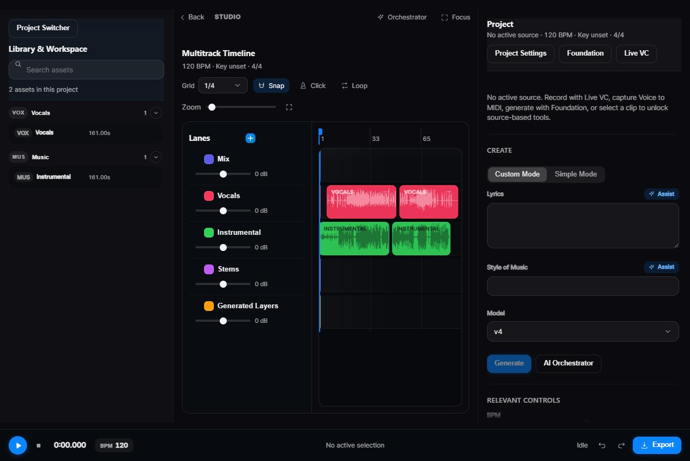
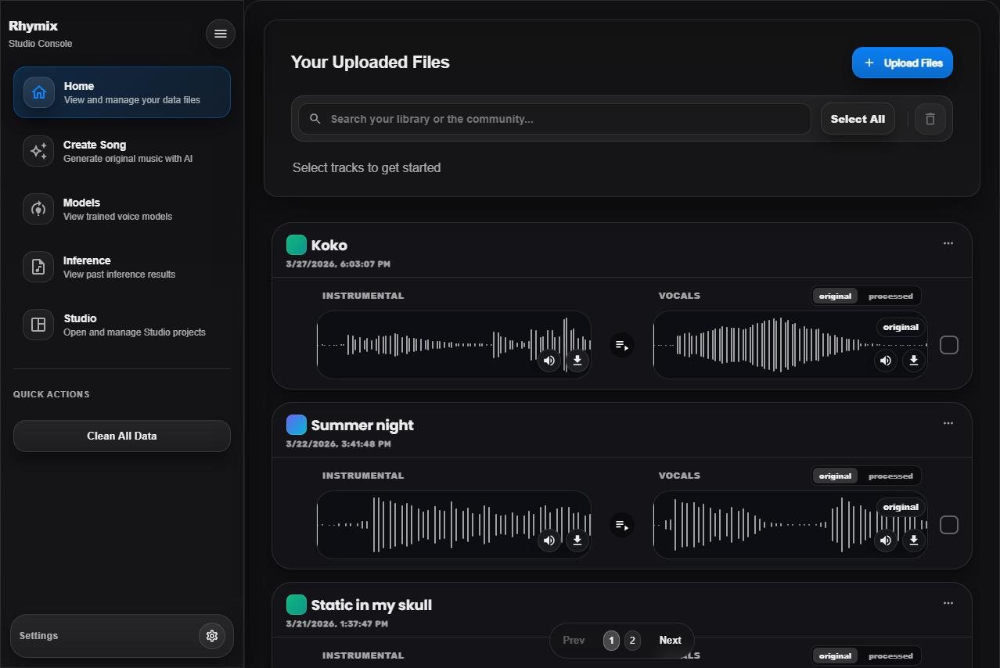
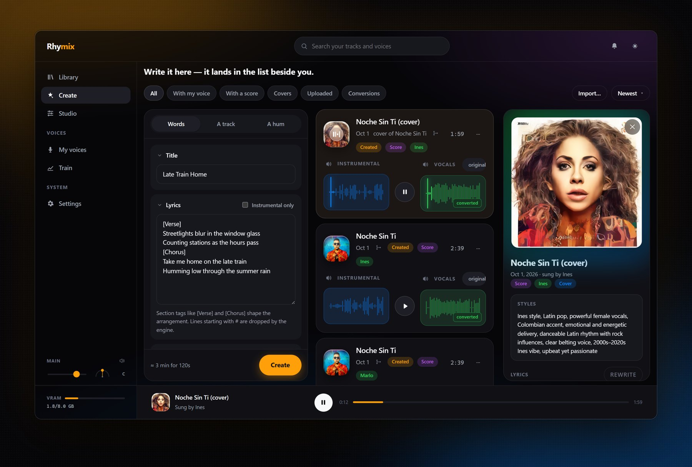
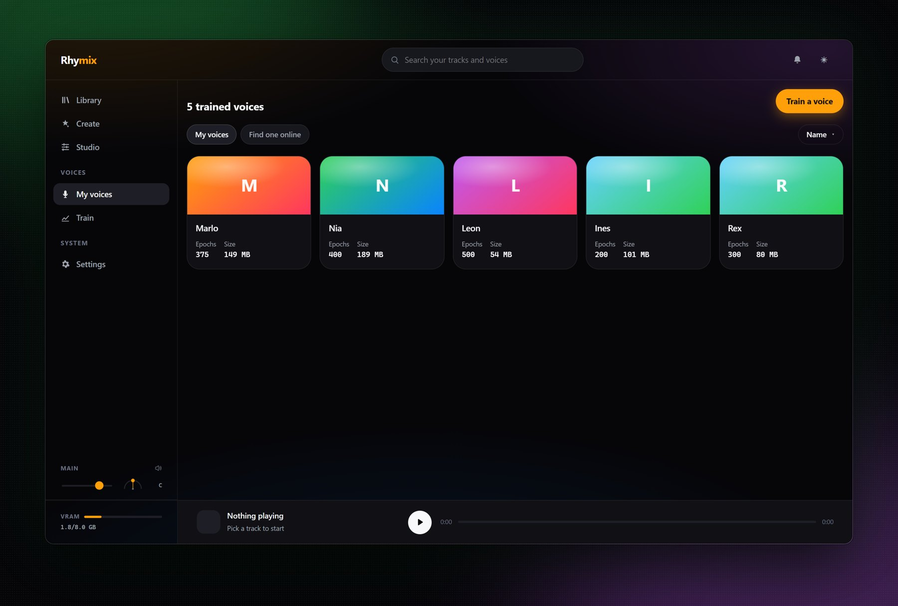

<div align="center">

# 🎛️ Rhymix

**A local Suno you can open up and edit — generate songs in any voice you own, on your own GPU, then mix them on a real timeline. No credits, no queue, no licence attached to the output.**


[](https://github.com/gashel01/Rhymix/actions/workflows/ci.yml)

</div>

---

> ### 🚧 This is a workbench, not a product
>
> Rhymix is a personal project and it has never tried to be anything else. There
> is no hosted version, no installer, no account system, no roadmap and no
> support. It runs on one machine — mine — against a pile of local model
> checkpoints, and half of it exists because I wanted to find out whether a
> browser could do it at all.
>
> Parts of it are polished. Parts of it are scaffolding with the paint still
> wet. Where something is half-wired, the code says so out loud rather than
> pretending otherwise. You are very welcome to read it, take ideas from it, or
> run it if you have the patience — but treat it as a workshop you are walking
> through, not a tool you are buying.

---

## The pitch

**Suno, on my own machine, singing in whatever voice I choose.**

That was the whole idea. Hosted generators are good, and then they stop being
good exactly where it matters: a monthly credit count, a queue, a voice you are
not allowed to use, and a licence attached to whatever comes out. None of those
are technical limits — they are the limits of running on someone else's
computer.

So Rhymix runs on mine. Every model is local: generation, voice conversion,
separation, transcription. Nothing is uploaded, nothing is metered, and any
voice you have a model for is a voice you can use.

The second half of the idea arrived later. A hosted generator hands back a
finished stereo file, and when the second verse is wrong your only move is to
roll the dice again. Generating locally is only half the win if the result is
still a sealed box — so the generator sits inside a real timeline. Generate a
part, drop it on a lane, re-sing one phrase, convert a voice, hum a bassline in
and quantise it, then mix it like any other audio.

A local Suno you can open up and edit. That is the target; the rest of this
README is how far along it is.

---

## Screenshots

<table>
  <tr>
    <td width="50%">
      
      <p align="center"><em><b>Studio</b> — multitrack timeline, per-lane faders, AI tools in the right panel</em></p>
    </td>
    <td width="50%">
      
      <p align="center"><em><b>Library</b> — every track with its instrumental and vocal stems side by side</em></p>
    </td>
  </tr>
  <tr>
    <td width="50%">
      
      <p align="center"><em><b>Create</b> — prompt, lyrics and a full YuE2 parameter panel</em></p>
    </td>
    <td width="50%">
      
      <p align="center"><em><b>Models</b> — trained voice models, with download and training progress live on the card</em></p>
    </td>
  </tr>
</table>

---

## What it does

### 🎚️ Studio — a real timeline
Non-destructive multitrack editing: lanes, clips, trims, fades, snap-to-grid,
looping, per-lane gain, mute and solo. Playback is a custom Web Audio graph —
one bus per lane with its own filter, distortion, echo, reverb and chorus nodes,
scheduled ahead of the playhead so toggling an effect mid-playback never clicks.
The mixdown is rendered server-side by ffmpeg from the same edit list the
browser plays.

### 🎤 Voice → MIDI
Hum, sing or beatbox into a microphone. An `AudioWorklet` captures PCM in real
time and streams it over a WebSocket; the backend runs pitch detection and sends
back notes, which land as a quantised MIDI clip on the timeline. Three
interchangeable engines — **Basic Pitch**, **CREPE** and **DDSP** — plus a
"magic wand" pass that snaps a take to a key and scale, merges the stutter that
pitch trackers produce on held notes, and applies swing.

### 🥁 Beatbox calibration wizard
Record a few examples of each drum sound in your own voice, train a small
classifier on them, and turn vocal percussion into drum MIDI.

### 🎵 AI song generation
Full songs from a prompt and lyrics, via **YuE2** running locally through
[WanGP](https://github.com/deepbeepmeep/Wan2GP). It plans the composition first —
writing melody and chords as an ABC score — and then performs it, which is what
lets it hand the score back.

That is the part that matters here. Turn on **Save Score** and a generated song
comes with its `.abc` and `.mid`; feed that back in with new lyrics and the
music survives while only the vocal is sung again. A generated track stops being
a sealed stereo file.

A hummed melody can go in instead of a prompt, and a source song can be
transcribed for a cover — both through the same engine.

> **Licence.** YuE2's weights are **CC BY-NC 4.0 — non-commercial**. Rhymix
> surfaces that on every generated job. This replaced ACE-Step (Apache-2.0),
> which was removed: YuE2 won on quality and, once its vllm decoder path was
> enabled, on speed too.

### 🎭 Voice conversion and training
Apply a trained **RVC v2** model to any track, or train a new one from your own
audio without leaving the browser. Runs stay visible while they work: a training
job survives a page reload, and its progress shows on the model's card in the
library.

### 🗣️ Speaker diarization
**pyannote** splits a multi-speaker recording into per-speaker
segments, drawn as coloured regions over a shared waveform, with per-speaker
export.

### 🎛️ And the rest
Stem separation, lyric transcription, song covers, and a Groq-backed assist
button on the prompt fields.

---

## Architecture

Three processes. The browser talks REST to one, WebSocket to another, and never
talks to a model directly.

```
┌──────────────────────────────────────────────────────────────────────┐
│  React 18  ·  :3001                                                  │
│                                                                      │
│  Studio          Library / Inference / Models / Training / Diarize   │
│  ├ store.js      reducer + undo stack, the single source of truth    │
│  ├ playback      Web Audio graph: lane buses, FX chain, scheduler    │
│  ├ selectors     pure — what a selection covers, which job is live   │
│  └ audioMath     dB↔gain, ticks↔seconds, note names, FX clamps       │
└───────────────┬──────────────────────────────────┬───────────────────┘
                │ REST                             │ WebSocket
┌───────────────▼──────────────┐   ┌───────────────▼───────────────────┐
│  Flask  ·  :5000             │   │  FastAPI  ·  :8002                │
│                              │   │                                   │
│  upload · processing · models│   │  /ws/voice_to_midi                │
│  training · studio · songgen │   │  /ws/studio_live_infer            │
│  diarization · beatbox       │   │                                   │
│                              │   │  streams PCM in, notes/audio out  │
│  project_edits  (pure)       │   └───────────────────────────────────┘
│  note_math      (pure)       │
└───────────────┬──────────────┘
                │ subprocess, one venv per engine
┌───────────────▼──────────────────────────────────────────────────────┐
│  YuE2 (WanGP)   Applio / RVC   UVR stems   pyannote                   │
│  SoulX-Singer   CREPE · Basic Pitch                                   │
└──────────────────────────────────────────────────────────────────────┘
```

**Why subprocesses.** Each engine wants its own torch build and its own pinned
dependency set — CUDA 11.8 here, 12.8 there — and they cannot coexist in one
interpreter. Each lives in its own virtualenv and is driven over a stdout line
protocol. It also means a model that crashes takes its own process down and not
the app.

**Why the pure modules.** Anything that decides something rather than performing
it was pulled out of the code that touches ffmpeg, a GPU or the DOM:
`project_edits`, `yue2_params`, `note_math` on the backend;
`studioSelectors`, `audioMath`, `appRoutes` and the per-view models on the
frontend. They are plain functions over plain data, so they can be tested in
milliseconds instead of by running a job. That is where most of this project's
tests live, and where four real bugs were found by writing them.

More detail in [`docs/ARCHITECTURE.md`](docs/ARCHITECTURE.md),
[`docs/STUDIO.md`](docs/STUDIO.md) and [`docs/API.md`](docs/API.md).

---

## Running it

You need a CUDA GPU, Python 3.10 and Node 18+. Model checkpoints are **not** in
this repository — see [`docs/SETUP_MODELS.md`](docs/SETUP_MODELS.md) for what to
download and where to put it.

```bash
py -3.10 -m venv venv
venv\Scripts\activate
pip install -r requirements.txt

cd frontend && npm install --legacy-peer-deps && cd ..

run_all.bat          # Flask :5000 · FastAPI :8002 · React :3001
```

Then open **http://localhost:3001**.

Developed against an **RTX 3070 Ti Laptop (8 GB)**, which is the reason for
every offload and quantisation default you will find in
`backend/features/song_generation/providers/yue2.py` and in WanGP's
`wgp_config.json`. On a larger card, turn them off.

---

## Tests

```bash
pytest tests/ backend/tests/ --ignore=backend/tests/test_dubler_melody.py
cd frontend && npm test
```

**546 tests**, none of which need a GPU, a model checkpoint or a network call.
They cover the parts where being wrong is quiet rather than loud — the payload
posted to the generator, the arithmetic that places a clip on the timeline, the
rules that decide which AI tools a selection unlocks, the conversion between
ticks and seconds.

The one excluded file is the CREPE test, which pulls in torch; everything else
runs in CI on every push.

---

## Honest status

Things worth knowing before you read the code:

- **No end-to-end generation has ever been run in CI**, or with a fresh model
  install. Correctness is asserted by tests and by use on one machine.
- **Some features are wired but not connected.** Where that is true the code
  says so, with the reason. `TalkDownloadResults` has a waveform sync that was
  never plugged in; the comment explains what is missing and why turning it on
  is not a one-line change.
- **Re-singing a selection layers rather than replaces.** The new audio lands on
  a "Generated Layers" lane over the original. That is deliberate — you mix the
  two — and the split-and-replace alternative was removed rather than left
  around as a suggestion.
- **`yue2_worker.py` prints instead of logging.** Those `print()` calls are the
  IPC protocol the worker subprocess speaks. They look like debug noise and are
  not.

The git history is written to be read. Commits explain why a change was made and
what was rejected, not just what moved.

---

<div align="center">
<sub>Built out of curiosity. Kept honest on purpose.</sub>
</div>
