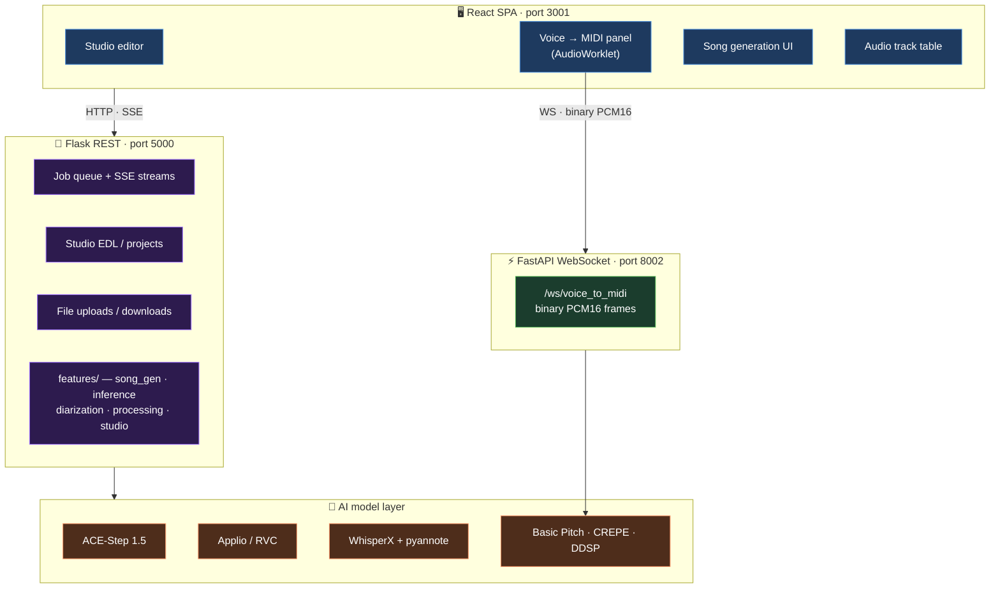

<div align="center">

# 🎛️ Rhymix

**A browser-based music production app built in React — DAW-style editor, real-time voice-to-MIDI, AI song generation, and voice conversion, all in one tab.**


[](https://github.com/gashel01/Rhymix/actions/workflows/ci.yml)

</div>

---

> 📸 **Screenshots / demo GIF coming soon** — Studio editor, Voice→MIDI panel, and song generation in action.

---

## What it is

Rhymix is a full-stack music production web app I built to explore how far you can push the browser as an audio engineering environment. The frontend is a React DAW with a custom Web Audio API playback engine, an AudioWorklet-based voice capture pipeline, a non-destructive timeline editor, and real-time MIDI rendering — all talking to a Python backend (Flask REST + FastAPI WebSocket) that routes work to AI models for song generation, voice conversion, vocal separation, and transcription.

The project started as "can I build a Dubler-style voice→MIDI tool in the browser?" and grew from there.

---

## ✨ Features

| | |
|---|---|
| 🎚️ **Studio — DAW editor** | Non-destructive timeline with lanes, clips, fades, looping, and a multi-lane Web Audio API mixing engine. |
| 🎤 **Voice → MIDI** | Hum or sing into a mic. An AudioWorklet captures PCM in real time, streams it over WebSocket, and drops a quantized MIDI clip into the timeline. Three pluggable pitch engines (Basic Pitch / CREPE / DDSP). |
| 🥁 **Beatbox Wizard** | Record vocal percussion and get a rhythm MIDI clip back, ready to insert into any lane. |
| 🎵 **AI Song Generation** | Generate complete songs from a text prompt + lyrics (ACE-Step foundation model). Result drops straight into the timeline. |
| 🎭 **Voice Conversion** | Apply a trained RVC voice model to any audio clip. Train new voice models from the browser. |
| 🗣️ **Speaker Diarization** | WhisperX + pyannote pipeline to separate multiple speakers in a recording. |
| 🎸 **Stem Extraction** | Pull drums / bass / guitar / keys out of an instrumental — each stem gets its own lane. |

---

## 🖥️ Frontend engineering

The frontend is where most of the interesting engineering lives. Some highlights:

### Custom Web Audio API playback engine (`useStudioPlayback`)
A 1,000-line custom hook that implements a DAW-grade playback engine from scratch:
- **Lookahead scheduler** — buffers audio events 750ms ahead using `AudioContext.currentTime` to avoid glitches when the JS thread is busy
- **Per-lane bus routing** — each Studio lane gets its own `GainNode` chain for independent volume, mute, and solo
- **Buffer cache** — decoded `AudioBuffer` objects are kept in a `Map` keyed by source URL to avoid re-decoding on loop
- **SoundFont/MIDI synthesis** — MIDI clips are synthesized in real time using a SoundFont player, with per-clip instrument override from the Inspector
- **Metronome** — generated with `OscillatorNode` + `GainNode` envelope, synced to project BPM
- **Race-condition safety** — playback token system ensures stale async callbacks from a previous play session never affect the current one

### AudioWorklet voice capture (`voiceToMidiWorklet.js`)
Runs in a **dedicated audio rendering thread** (not the main JS thread):
- Accumulates `Float32` PCM frames from the mic input
- Converts to `Int16` little-endian and ships frames to the main thread via `postMessage` with **transferable `ArrayBuffer`s** (zero-copy — no serialization overhead)
- The main thread hook (`useVoiceToMidiWs`) forwards each frame to the FastAPI WebSocket server as binary, and reconstructs a MIDI clip from the final response

### Non-destructive EDL (`edlOps.js` + `studio/store.js`)
All timeline edits are **pure functions over the EDL** — split, trim, duplicate, move, fade — nothing mutates in place:
- Makes undo/redo trivial to implement (the state IS the history)
- AI jobs write their output back as new EDL operations, keeping human edits and AI edits consistent
- `edlOps.test.js` covers the core operations — the kind of code that actually needs tests

### Real-time WebSocket hooks
Two custom hooks manage binary streaming:
- `useVoiceToMidiWs` — opens a WS connection, feeds Int16 PCM frames from the worklet, handles `status/error/final` message types, injects the returned MIDI clip into the EDL
- `useStudioLiveInferenceWs` — manages an SSE + WS stream for live AI inference feedback during generation jobs

### Other frontend details worth mentioning
- **`useStudioKeyboardShortcuts`** — context-aware shortcut system that correctly skips `<input>`, `<textarea>`, `contentEditable`, and conditionally active modals before firing any action
- **`MidiOverlay`** — custom piano-roll renderer overlaid on the waveform timeline
- **`Inspector`** (1,630 lines) — context-sensitive properties panel for clips, lanes, and the project; updates in sync with selection state
- **`ClipView`** (997 lines) — handles waveform rendering, clip resize handles, fade in/out curves, drag-to-move, and snap-to-grid
- **`Timeline`** (584 lines) — ruler, playhead, loop region, click-to-seek, scroll sync

---

## 🗂️ Frontend structure

```
frontend/src/
├── studio/                     # DAW editor (the core of the app)
│   ├── StudioPage.js           # Root layout and state wiring
│   ├── store.js                # Studio state store (actions + reducers)
│   ├── edlOps.js               # Pure-function EDL operations (+ tests)
│   ├── components/
│   │   ├── Timeline.js         # Ruler, playhead, loop region
│   │   ├── ClipView.js         # Clip rendering, drag, resize, fades
│   │   ├── TrackList.js        # Lane list with mute/solo/volume
│   │   ├── Inspector.js        # Context-sensitive properties panel
│   │   ├── MidiOverlay.js      # Piano-roll overlay renderer
│   │   ├── VoiceToMidiPanel.js # Mic recording + engine controls
│   │   ├── Transport.js        # Play/pause/stop/BPM/loop controls
│   │   └── ...13 more
│   ├── hooks/
│   │   ├── useStudioPlayback.js        # Web Audio engine
│   │   ├── useVoiceToMidiWs.js         # Binary PCM WebSocket stream
│   │   ├── useStudioLiveInferenceWs.js # AI job SSE stream
│   │   ├── useStudioKeyboardShortcuts.js
│   │   └── useLyricsActions.js
│   └── audio/
│       └── voiceToMidiWorklet.js       # AudioWorklet (audio thread)
├── components/
│   ├── AudioTrackTable/        # Main asset list with waveform previews
│   ├── CreateSongView/         # AI song generation form + results
│   ├── Homeview/               # Design-system primitives (Glass, Panel, Btn...)
│   └── ...
├── beatboxWizard/              # Mic → rhythm MIDI wizard (TypeScript)
├── contexts/                   # VolumeContext
├── hooks/                      # Shared hooks (waveform sync, vocal mode, files)
└── utils/
```

---

## 🔧 Full-stack architecture

Rhymix is three processes. The frontend talks REST + SSE to Flask for everything persistent (projects, jobs, uploads), and streams binary audio directly to FastAPI over WebSocket for the realtime voice pipeline.



---

## 🧰 Tech stack

**Frontend**
- React 18, Material-UI, wavesurfer.js
- Web Audio API — `AudioContext`, `AudioWorklet`, `GainNode`, `OscillatorNode`, `AudioBuffer`
- WebSocket (binary PCM streaming), SSE (job progress)
- SoundFont-based MIDI synthesis (`soundfont-player`)
- AG Grid (`@tanstack/react-virtual`)
- TypeScript (partial — `beatboxWizard/`)

**Backend**
- Flask 2.2 (REST API, file I/O, job queue)
- FastAPI + uvicorn (WebSocket, async audio streaming)
- Python 3.10, PyTorch 2.4.1, CUDA 12.1

**AI models** (integrated, not authored)
- ACE-Step 1.5, Applio/RVC, WhisperX, pyannote.audio, Basic Pitch, CREPE, DDSP

---

## 🚀 Quickstart

> Windows · Python 3.10 · Node 18+ · Git · CUDA 12.1 GPU (recommended)

```bash
git clone https://github.com/gashel01/Rhymix.git
cd Rhymix
setup.bat          # venv, deps, AI repos, whisperX venv, npm install
# Download model weights → see docs/SETUP_MODELS.md
run_all.bat        # starts Flask + FastAPI + React dev server
```

Open **http://localhost:3001**

For configuration (60+ env vars) see [docs/CONFIGURATION.md](docs/CONFIGURATION.md).
For model weights see [docs/SETUP_MODELS.md](docs/SETUP_MODELS.md).

---

## 🧪 Tests

```bash
# Backend (Python)
pytest tests/

# Frontend EDL operations
cd frontend && npm test -- --testPathPattern=edlOps
```

CI runs both on every push — see `.github/workflows/ci.yml`.

---

## 📚 Documentation

| | |
|---|---|
| [docs/ARCHITECTURE.md](docs/ARCHITECTURE.md) | Request flow, job system, AI adapter pattern |
| [docs/STUDIO.md](docs/STUDIO.md) | Studio mode, Voice→MIDI, Magic Wand, stem extraction |
| [docs/API.md](docs/API.md) | REST endpoints + WebSocket protocol |
| [docs/CONFIGURATION.md](docs/CONFIGURATION.md) | Every environment variable |
| [docs/SETUP_MODELS.md](docs/SETUP_MODELS.md) | Model weight downloads and folder layout |

---

## 🙏 Credits

AI models used as backends: [ACE-Step](https://github.com/ace-step/ACE-Step), [Applio/RVC](https://github.com/IAHispano/Applio), [WhisperX](https://github.com/m-bain/whisperX), [pyannote.audio](https://github.com/pyannote/pyannote-audio), [Basic Pitch](https://github.com/spotify/basic-pitch), [CREPE](https://github.com/marl/crepe), [DDSP](https://github.com/magenta/ddsp), [SoulX-Singer](https://github.com/Soul-AILab/SoulX-Singer).

Built by **gg**.
